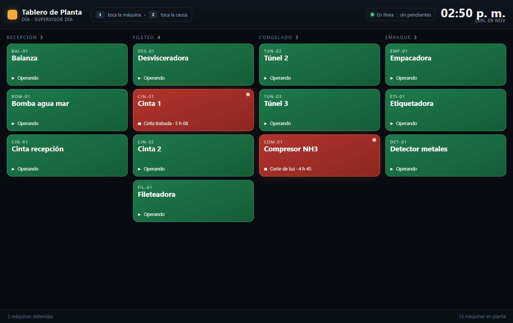
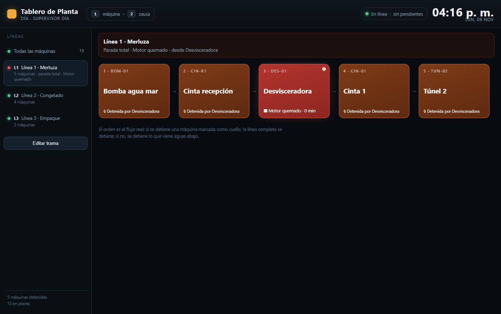
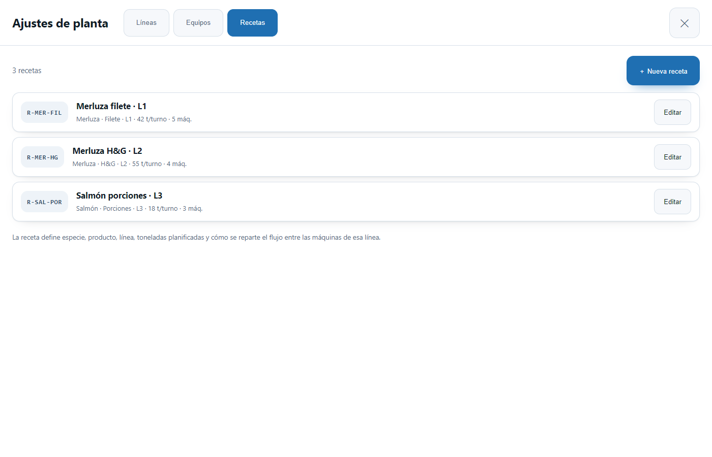

# Registro de paradas de planta · propuesta técnica

Sistema de captura de detenciones (2 toques), operación offline en tablets y analítica de causa raíz
para planta de procesamiento pesquero.



**Estado:** base desplegada en Neon (PostgreSQL 18.6) · 17/17 pruebas pasando · PWA funcional contra esa base.

## Contenido

| Archivo | Qué es |
|---|---|
| `propuesta-paradas-planta.html` | Documento técnico completo (modelo, arquitectura, offline, UX, Pareto, hardware, plan). Se abre con doble clic. |
| `mockup-tablet.html` | Prototipo navegable del tablero: toca una máquina → causa, y una máquina roja → reanudar. |
| `app/` | **Aplicación real**: PWA (React + Vite + Dexie) y API (Fastify) contra la base de Neon. |
| `sql/esquema_paradas.sql` | Esquema completo: tablas, restricciones, índices, vistas, funciones y triggers. |
| `sql/002_turno_auto.sql` | Crea el turno del día si nadie lo creó (el operador nunca ve «no existe turno»). |
| `sql/003_borrado_seguro.sql` | Corrige la auditoría de DELETE y bloquea el borrado de paradas. |
| `sql/004_lineas.sql` | Líneas, tramas (secuencia de máquinas) y propagación de la parada. |
| `sql/005_semilla_lineas.sql` | Tres líneas de demostración con su cuello de botella. |
| `sql/006_tramas_sin_solape.sql` | Corrige tramas que compartían máquinas entre líneas. |
| `sql/007_recetas.sql` | Especies, productos, recetas y distribución por máquina. |
| `sql/008_semilla_recetas.sql` | Recetas de demostración (merluza, salmón, jibia). |
| `sql/semilla_demo.sql` | Datos de demostración (171 paradas, 13 máquinas, 4 áreas, 28 turnos). |
| `sql/reset_demo.sql` | Deja la base vacía (borra todo el esquema). |
| `pruebas/pruebas.js` | 23 pruebas: integridad, 2 clics, offline, borrado, propagación y administración. |

## Estado

- Base creada en **Neon · proyecto OEE. PROCESOS** (org Processing, `aws-sa-east-1`, PostgreSQL 18.6).
- Datos de demostración cargados.
- **16/16 pruebas pasando contra esa base.**

## Uso

```bash
# esquema (una vez)
psql "$DATABASE_URL" -f sql/esquema_paradas.sql

# datos de demostración (opcional)
psql "$DATABASE_URL" -f sql/semilla_demo.sql

# pruebas
cd pruebas && npm i pg && PGURL="$DATABASE_URL" node pruebas.js

# dejar la base limpia
psql "$DATABASE_URL" -f sql/reset_demo.sql
psql "$DATABASE_URL" -f sql/esquema_paradas.sql
```

`DATABASE_URL` es la cadena de conexión del proyecto en Neon (usa el endpoint directo, sin `-pooler`,
para las migraciones).

## Decisiones que no conviene revertir

1. **`uuid_cliente` único** — sin esto, cada reintento de red crea una parada falsa.
2. **Índice único parcial de parada abierta por máquina** — evita el doble registro de dos operadores.
3. **`es_planificada` en el catálogo de causas** — sin esto el Pareto acusa a Operaciones de tiempo planificado.
4. **Duración calculada en vista, no almacenada** — una corrección de horas se refleja al instante.
5. **Nada se borra** — anulación con motivo + auditoría con diff de campos.

## Líneas de producción y propagación



La planta trabaja en flujo continuo, así que cada máquina vive en una **trama** (secuencia
ordenada dentro de una línea). Una parada se propaga según el criterio configurado:

| Rol de la máquina en la trama | Alcance de la parada | Qué se detiene |
|---|---|---|
| `detiene_linea = true` (cuello de botella) | `linea` | La línea completa, aguas arriba y aguas abajo |
| `detiene_linea = false` | `aguas_abajo` | Solo las máquinas siguientes en la secuencia |
| Máquina fuera de toda línea | `maquina` | Solo ella |

- El criterio se guarda en `linea_maquinas.detiene_linea`, **no** se pregunta al operador: se mantienen los 2 toques.
- Cada línea tiene su trama y sus máquinas: no todas las líneas comparten el mismo equipamiento.
- El panel lateral muestra las líneas con su estado (`operando` / `parada parcial` / `parada total`),
  la causa y la máquina de origen.
- **Editar trama** permite agregar, quitar y reordenar máquinas y marcar el cuello de botella
  (solo uno por línea). Se guarda con `PUT /api/lineas/:id/trama`.
- Una parada se registra **una sola vez**: las máquinas arrastradas se marcan como afectadas
  (`v_maquinas_afectadas`), no se duplican registros. Para minutos-máquina existe
  `v_paradas_efectivas`; el Pareto sigue contando el evento una vez.

## Ajustes de planta (administración)

Botón de engranaje en la cabecera → panel **Ajustes** con tres pestañas:



| Pestaña | Qué permite |
|---|---|
| **Líneas** | Crear líneas, editar código/nombre/descripción, activar o desactivar, y abrir la trama para agregar, quitar y reordenar máquinas y marcar el cuello de botella. |
| **Equipos** | Alta y edición de máquinas (área, código, nombre, nombre corto, criticidad) y activación/desactivación. Se agrupan por área. |
| **Recetas** | Especie, producto, línea, toneladas por turno, rendimiento, vigencia y **distribución del flujo por máquina** (porcentaje por equipo de la línea). Se pueden crear especies y productos desde el mismo formulario con «＋». |

Un equipo desactivado deja de aparecer en el tablero pero conserva su historial: las paradas
antiguas siguen apuntando a esa máquina. Igual criterio para líneas y recetas.

### Modelo de recetas

- `especies` y `productos` (con su especie) son catálogos simples.
- `recetas` une especie + producto + línea y guarda toneladas por turno, rendimiento y vigencia.
- `receta_maquinas` guarda la **distribución**: qué porcentaje del flujo pasa por cada máquina
  de esa línea (ej. fileteadora 65%, túnel 35%).
- `v_recetas` entrega la receta ya resuelta para el panel.

## App funcional

La app corre contra la misma base de Neon (no hay mock).

```bash
cd app
npm install
# .env con: DATABASE_URL=postgresql://... (endpoint directo de Neon), APP_TOKEN=demo
npm run build
npm start            # http://localhost:8787
```

- **Tablero**: 4 áreas, tarjetas por máquina con estado real desde `v_paradas`.
- **2 clics**: máquina → categoría → causa. El cierre es máquina → «Reanudar».
- **Offline**: IndexedDB (Dexie) + cola `outbox` + service worker. La app abre sin red y los
  registros se envían solos al reconectar (probado en frío y con la pestaña abierta).
- **Sincronización**: `POST /api/sync` aplica aperturas con `fn_sync_lote()` y cierres con
  `fn_cerrar_parada()`; cada evento se confirma por id.
- **Deshacer**: 5 segundos para revertir un registro antes de que salga de la cola.

### Limitaciones de esta versión

1. El token de la tablet es fijo (`APP_TOKEN=demo`). Falta JWT de turno y roles.
2. No existe todavía pantalla de historial ni de administración de catálogos.
3. Las paradas que llegan por la cola se guardan con `origen = 'offline'` aunque la tablet
   tuviera red al registrarlas (el evento siempre pasa por la cola local).
4. El frontend está en JSX sin tipos; el paso a TypeScript es mecánico.

## Zona horaria

El script fija `America/Punta_Arenas` en `fn_turno_para()`, `v_paradas` y el índice `ix_paradas_dia`.
Si la planta cambia de zona, se reemplaza en esos tres puntos.
